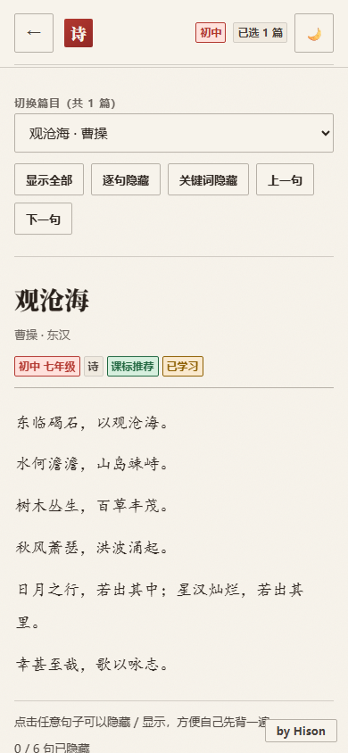
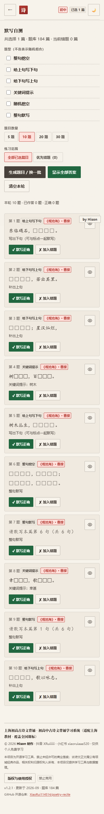
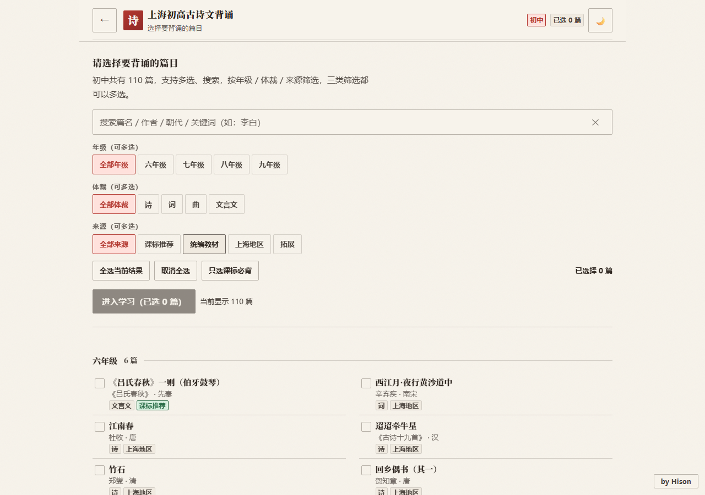
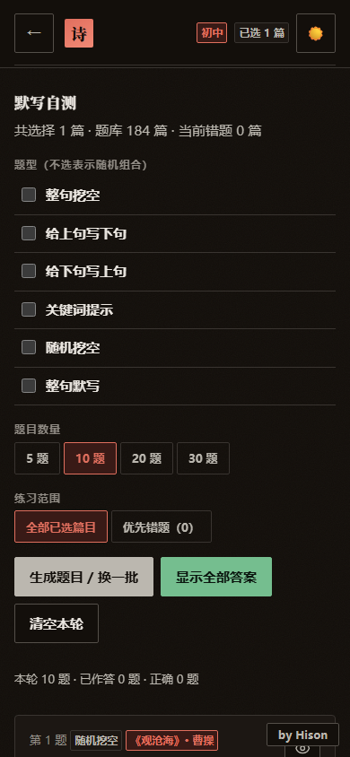
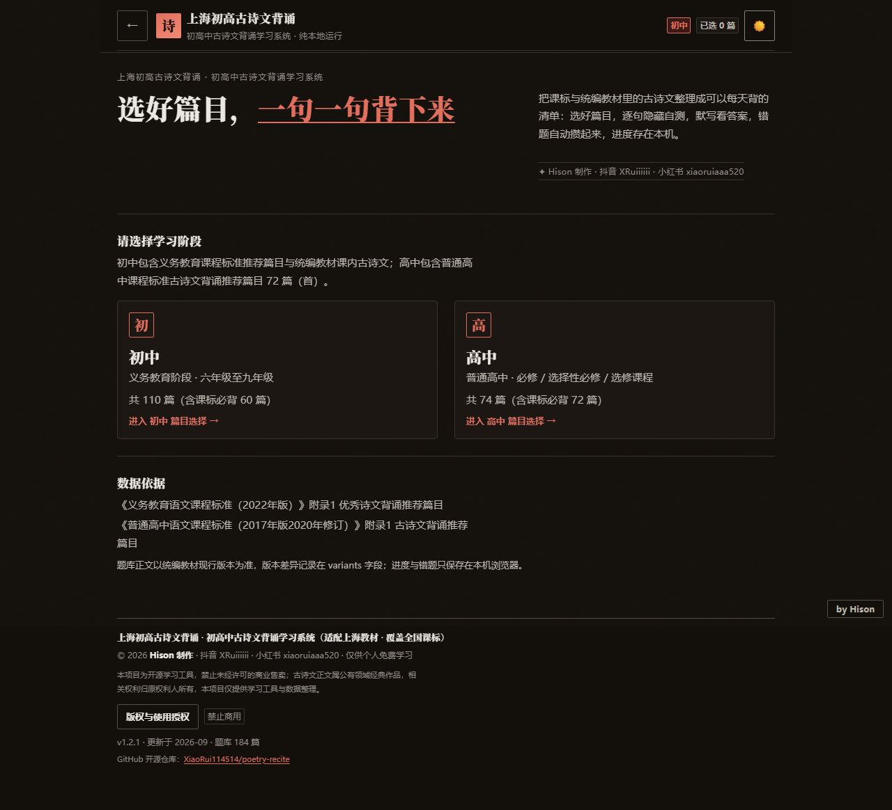

# 上海初高古诗文背诵

> 初高中古诗文背诵学习系统 · 纯前端 · 免安装 · 可离线 · 支持深色模式 · 可直接部署到 GitHub Pages

把「上海中考古诗词默写自测」升级成一个可以每天拿来用的静态学习工具：
选学段 → 勾篇目 → 读全文 → 自己背诵 → 默写自测 → 看答案 → 错题再练 → 刷新还在。

Hison 制作 · 抖音 XRuiiiiii · 小红书 xiaoruiaaa520 · 仅供个人免费学习

---

## 界面预览

| 学习阶段选择（手机） | 全文学习 · 逐句隐藏（手机） | 默写自测（手机） |
| --- | --- | --- |
|  |  |  |

| 篇目选择（电脑） | 深色模式 · 默写自测（手机） |
| --- | --- |
|  |  |

深色模式（电脑，学习阶段页）：



---

## 一、项目介绍

- **纯前端**：不需要后端、不需要数据库、不需要服务器，打开 `index.html` 就能用。
- **离线可用**：整个题库与逻辑都在本地，断网也能背诵、默写、记录进度。
- **深色模式**：可在顶栏一键切换浅色 / 深色，默认跟随系统，选择记在本机。
- **多端适配**：手机、平板、电脑都做了响应式适配（Playwright 已在 390 / 834 / 1280 三种宽度实测）。
- **题库可扩充**：数据与逻辑分离，新增篇目只改 `data/` 目录，不用动页面代码。
- **进度本地化**：选择、进度、默写统计、错题本都存在浏览器 `localStorage`，不做账号、不上传数据。

## 二、功能介绍

| 模块 | 说明 |
| --- | --- |
| 学习阶段选择 | 进入系统先选「初中 / 高中」，不直接堆题库 |
| 篇目选择 | 多选、全选当前结果、取消全选、只选课标必背、已选快速查看 |
| 搜索 | 支持篇名、作者、朝代、年级、体裁、来源，以及正文关键词（例如搜「李白」） |
| 筛选 | 初中按年级（六年级~九年级）、高中按课程模块（必修 / 选择性必修 / 选修）；体裁（诗 / 词 / 曲 / 文言文）、来源（课标推荐 / 统编教材 / 上海地区 / 拓展）。**三类筛选都可以多选并互相叠加** |
| 全文学习 | 点击句子隐藏/显示（□ 挖空）、显示全部、逐句隐藏、关键词隐藏、上一句/下一句；**每句原文下面附一句现代汉语翻译**，翻译严格跟随该句原文的显示状态（原文完整显示时才显示，原文隐藏时同步隐藏，且用 `visibility` 保留占位，隐藏 / 显示都不会让诗句整段上移） |
| 考试重点 ★ | 每篇的考试重点句在原文左侧显示 `★`（全库 184 篇 / 620 句）。星标**不写进诗文正文**，而是独立的 `examFocus` 元数据（只存句子下标 + 内部依据），页面用独立的 marker 元素渲染：marker 列宽固定，有没有 ★ 都由 CSS 留位，所以原文横向位置在任何状态下都完全一致；星标随原文同步隐藏（逐句隐藏 / 关键词隐藏 / 单句隐藏时一起隐藏，且仍占位） |
| 中心思想 / 主旨 | 每篇在诗文之后附一段简短的「中心思想」（文言文）或「主旨」（诗词），属于文章级信息，不重复出现在每句下面 |
| 默写自测 | 6 种题型随机组合：整句挖空、给上句写下句、给下句写上句、关键词提示、随机挖空、整句默写 |
| 答案交互 | 默认隐藏、单题展开/收起、显示全部答案 / 隐藏全部答案（沿用原项目的展开动画） |
| 判分与错题 | 每题可标记「默写正确 / 加入错题」，一题只记一次分；错题自动进错题本，可「再练一次」只练该篇 |
| 我的进度 | 已学习篇目、今日默写次数、累计正确率、练习记录、错题本、重置本地数据 |
| 学习提示 | 每篇附「名句」「易错字」提示，点击即可查看 |
| 深色 / 浅色 | 顶栏一键切换，跟随系统偏好，刷新后保持 |
| 作者署名 | 顶栏品牌、首页品牌标签、右下角「by Hison」水印（鼠标悬停时原地展开成署名卡片：Hison 制作 + 抖音 / 小红书）、页脚署名与版权授权弹窗 |

## 三、使用方法

### 1. 最快的方式：只用单文件版

直接双击 `dist/上海初高古诗文背诵.html`（或 `dist/index.html`）即可，无需任何环境。

### 2. 本地开发（模块化版本）

```bash
npm run dev              # 启动本地静态服务器 http://localhost:5173
npm run build            # 生成 dist/ 下的单文件版本（并自检：数据数量必须源 = 打包）
npm test                 # 全量检查：单元 + 数据体检 + 构建自检 + 端到端
npm run test:unit       # 单元检查（零依赖，含数据层 / 存储 / 日期 / 出题逻辑）
npm run test:data       # 题库体检（原始数据层字段、重复分级、文档一致性）
npm run test:e2e:install # 首次跑端到端测试前安装 Playwright 自带的 Chromium
npm run test:e2e        # Playwright 端到端测试（默认自带 Chromium；PW_CHANNEL=msedge 可改用 Edge）
```

> 端到端测试默认使用 Playwright 自己管理的 Chromium（`npm run test:e2e:install` 一次即可），
> 不要求机器上预装 Microsoft Edge；需要复用 Edge 时设置环境变量 `PW_CHANNEL=msedge`。

### 3. 部署到 GitHub Pages

1. 新建一个仓库，把本项目推上去；
2. 仓库 → Settings → Pages → Source 选择 `Deploy from a branch`，分支选 `main`，目录选 `/ (root)`（这样线上就是模块化版本）；
3. 或者把 `dist/index.html` 单独放到 `gh-pages` 分支 / 仓库根目录，做成单文件站点。

> 模块化版本使用普通 `<script src>` 加载（不是 ES Module），所以在 `file://` 协议下直接双击 `index.html` 也能运行。

## 四、目录结构

```
.
├─ index.html                  # 模块化版本入口（可直接双击打开，含主题预置脚本）
├─ assets/styles.css           # 样式（浅色 / 深色双主题 + 品牌区块）
├─ tokens.css                  # 设计令牌导出（可移植到其他项目；运行时令牌仍在 styles.css）
├─ design.md                   # 锁定的设计系统说明（genre / 版面 / 字体 / 色彩 / 动效）
├─ data/
│  ├─ metadata.js              # 分类体系、数据来源、作者品牌、版本信息
│  ├─ junior.js                # 初中题库（课标 60 篇 + 统编教材 + 上海地区 + 拓展）
│  ├─ senior.js                # 高中题库（课标 72 篇 + 统编教材）
│  └─ database.js              # 题库读取层（校验 / 查询 / 统计）
├─ js/
│  ├─ utils.js                 # 标点安全切分、挖空、工具函数
│  ├─ storage.js               # localStorage 容错读写与学习数据
│  ├─ brand.js                 # 作者品牌层（署名 / 印章 / 页脚 / 授权弹窗 / 隐形指纹 / 自愈）
│  ├─ study.js                 # 全文学习模式（逐句隐藏 + 逐句翻译 + 考试重点 ★，显隐严格跟随原文）
│  ├─ quiz.js                  # 默写自测（6 种题型 + 判分 + 错题）
│  └─ app.js                   # 状态管理、路由、主题切换与页面渲染
├─ data/translations/          # 逐句翻译的原文清单（in/）与译文（poems/）
├─ build.js                    # 单文件打包脚本（注入品牌样式与版本号）
├─ tools/serve.mjs             # 本地静态服务器（开发 / 测试用）
├─ tools/check-dist.cjs        # 构建产物自检（源数据 = 打包数据、离线、相对路径大小写）
├─ tools/qa-data.cjs           # 题库体检（原始数据层字段、逐句翻译对齐、考试重点下标、中心思想、重复分级、文档一致性；有 ERROR 即失败）
├─ tools/qa-text.cjs           # 按 id 抽查篇目正文，例如 node tools/qa-text.cjs guan-cang-hai
├─ tools/translations/         # 逐句翻译的分批、校验、写回题库工具
├─ tools/meta/                 # 中心思想 / 考试重点的导出与写回工具
├─ tests/
│  ├─ unit.mjs                 # 单元检查（题库完整性、逐句翻译对齐、考试重点下标、切分、存储容错）
│  ├─ e2e.spec.mjs             # 端到端测试
│  └─ responsive.spec.mjs      # 手机 / 平板 / 桌面响应式测试
├─ docs/AI题库维护规范.md       # 用 AI 扩充题库的标准流程与 JSON 规范
├─ docs/逐句翻译维护规范.md      # 逐句翻译的数据流、字段约定与维护命令
├─ docs/考试重点与中心思想维护规范.md  # 星标判定依据、中心思想写法与维护命令
└─ dist/                       # 构建产物（单文件版）
```

## 五、题库规模与数据来源

当前题库共 **184 篇（段）**：

| 学段 | 数量 | 构成 |
| --- | --- | --- |
| 初中 | 110 | 课标推荐 60 + 统编教材课内 38 + 上海地区 6 + 拓展 6 |
| 高中 | 74 | 课标推荐 72 + 统编教材课内 2 |

依据的官方文件（优先于任何博客、题库网站或个人整理）：

1. 《义务教育语文课程标准（2022年版）》附录1「优秀诗文背诵推荐篇目」——7～9 年级 **60 篇（段）**
   <http://www.moe.gov.cn/srcsite/A26/s8001/202204/t20220420_619921.html>
2. 《普通高中语文课程标准（2017年版2020年修订）》附录1「古诗文背诵推荐篇目」——**72 篇（首）**：文言文 32 篇（必修 10、选择性必修 10、选修 12）+ 诗词曲 40 首
   <http://www.moe.gov.cn/srcsite/A26/s8001/202006/t20200603_462199.html>
3. 统编（部编）语文教材课内古诗文与「课外古诗词诵读」篇目
4. 上海地区：上海使用五四学制，六年级属于初中预备年级；相关篇目标记为「上海地区」，属辅助分类

每一条数据都带有 `sourceType`（课标推荐 / 统编教材 / 上海地区 / 拓展）与 `source` 字段，注明出处，不做「全国统一篇目」的强行归并。

### 关于篇目归属与异文

- 课标只规定篇目、不规定年级：初中按统编教材 / 上海五四学制安排填写年级；确实跨年级的篇目用 `grades` 多年级数组（例如《孟子》三则同时属于八年级、九年级）。
- 高中不再写「高一 / 高二 / 高三」这类按学校进度推断的值，而是按**课程模块**标注：文言文 32 篇按课标附录1 分为必修 10 / 选择性必修 10 / 选修 12；课标推荐的 40 首诗词曲按统编教材归属并入模块——必修上/下 → 必修，选择性必修上/中/下 → 选择性必修，其余不在统编必修 / 选择性必修教材内的 8 首 → 选修（各条 notes 里有说明）。因此高中模块为 **必修 27 / 选择性必修 27 / 选修 20**。
- 存在版本差异的正文，写进 `variants` 字段（例如「天将降大任于是人也」与旧版「于斯人也」）。

## 六、数据结构

```js
{
  id: 'guan-cang-hai',            // 唯一英文标识（新增篇目不要重复）
  title: '观沧海',
  author: '曹操',
  dynasty: '东汉',
  stage: '初中',                   // 学段：初中 / 高中
  grade: '七年级',                 // 初中：六年级~九年级；高中：必修 / 选择性必修 / 选修（课程模块）
  grades: ['八年级', '九年级'],     // 可选：跨年级篇目（如《孟子》三则），用于年级多选筛选
  genre: '诗',                     // 体裁：诗 / 词 / 曲 / 文言文 / 其他
  sourceType: '课标推荐',           // 来源：课标推荐 / 统编教材 / 上海地区 / 拓展
  required: true,                  // 是否核心必背（课标推荐篇目）
  recommended: true,               // 是否推荐学习
  text: '东临碣石，以观沧海。……',     // 正文（全角标点，与教材一致）
  source: '《义务教育语文课程标准（2022年版）》附录1 · 7~9年级第4篇',
  notes: '',                       // 可选：说明（如课标指定节选范围）
  highlights: [                    // 可选：背诵提示，供出题与学习页使用
    { type: '名句', text: '日月之行，若出其中；星汉灿烂，若出其里。' },
    { type: '易错字', text: '碣石 澹澹 竦峙 萧瑟' }
  ],
  variants: [{ label: '版本差异', text: '……' }],   // 可选：异文
  tags: ['建安', '山水']            // 可选：标签
}
```

## 七、如何新增古诗文

1. 打开 `data/junior.js` 或 `data/senior.js`，在数组末尾按上面的结构添加一条；
2. `id` 用拼音短横线命名，且全局唯一；
3. 正文使用全角标点（，。！？；：、），不要手动插入换行；
4. `grade` 只能填 `metadata.grades` 里登记过的值（初中：六年级~九年级；高中：必修 / 选择性必修 / 选修）；跨年级篇目加 `grades` 数组；
5. 运行 `node tests/unit.mjs` 自检（会检查 id 唯一、正文非空、年级 / 体裁 / 来源能被筛选到等）；
6. 运行 `node tools/qa-data.cjs` 做一次题库体检；
7. 运行 `npm run build` 重新生成单文件版。

更规范的做法（尤其是让 AI 帮忙补充篇目时）：见 [docs/AI题库维护规范.md](docs/AI题库维护规范.md)。

> 查重规则（第二轮审计后统一）：`标题 + 作者 + 学段 + 正文（去空白）` 完全相同 = **ERROR**，直接判定重复；
> 只有 `标题 + 作者` 相同但正文 / 学段不同（例如初中与高中各自的《论语》十二章）= **WARN**，需要人工确认，不算重复。

## 八、日期与“今日默写”的口径

- “今日”一律按**浏览器本地时间**计算（本应用是纯本地离线工具，设备上的日历日期就是用户认知里的“今天”）；
- 所有日键都由 `js/utils.js` 的 `todayKey()` 生成 / 校验（`YYYY-MM-DD`），业务代码不要自己拼日期；
- 不混用 UTC：不使用 `toISOString()` 等 UTC API，避免 UTC+8 凌晨被算成前一天；`todayKey('2026-09-13')` 这类日键字符串会原样返回，不会因时区偏移一天；
- 每日数据只保留最近 60 天，加载时按日期升序排序，非法日期会被丢弃。

## 九、深色模式与主题

- 顶栏右侧的 🌙 / ☀️ 按钮切换深色、浅色模式；
- 没有手动选择过时，**默认跟随系统**（`prefers-color-scheme`）；
- 选择保存在本机 `localStorage` 的 `hison-poetry-theme`，刷新后保持；
- 相关样式都在 `assets/styles.css` 顶部的 `:root` 与 `html[data-theme='dark']` 两组变量里，改颜色只需改这两处；
  设计系统的完整说明见 `design.md`，可移植的令牌导出见 `tokens.css`（改令牌后两者要同步，并重跑 `node build.js`）。

## 十、如何扩展题型

题型集中在 `js/quiz.js`：

1. 在 `MODES` 数组里登记新题型（key、名称、说明）；
2. 如果新题型需要新的题干形式，在 `buildQuestion()` 里增加一个分支，返回下面这样的对象：
   - `key`：唯一标识（用于防重复出题）
   - `poemId / poemTitle / poemAuthor / mode / modeLabel`
   - `promptHtml`：题干（已转义，可含 `<span class="blank-unit">□□</span>`）
   - `answerText`：答案；`hint`：可选提示
3. 题型数据来自 `unitsOf(poem)`（句 / 小句 / 上下句对），可复用它继续做「按词组挖空」「按易错字挖空」等；
4. 提交前跑一遍 `npm run test:e2e`。

## 十一、测试与质量

```bash
npm run test:unit    # 260+ 项单元检查：加载顺序、原始数据层、切分挖空、存储不变量、日期策略、出题逻辑
npm run test:data    # 题库体检：原始数据字段 / 重复分级 / 与 README、metadata、package 的一致性
npm run build        # 构建自检：源数据条数 === 打包产物条数（184 → 184），并确认运行时完全离线
npm run test:e2e     # 端到端用例（桌面 + 平板 + 手机），包含 file:// 单文件版直开
```

已覆盖的场景包括：初中/高中选择、多选与取消、全选、搜索、年级（可多选）/课程模块/体裁/来源筛选、进入学习、逐句隐藏与关键词隐藏、上一句/下一句、多种默写题型、展开答案、判分、错题本、刷新持久化、localStorage 被清空或损坏、空题库、单篇与几十篇、长文言文排版、篇名含括号、词牌名、特殊标点、深色模式切换与记忆、作者署名与授权弹窗、隐形指纹反查、手机/平板/桌面尺寸、控制台无报错、单文件版与模块化版本都可用 `file://` 直接打开、所有按钮无死按钮、中文编码无乱码。

第二轮审计补充的针对性用例：非法 / 未选中 / 跨学段的“只练这一篇”链接必须回退到全部篇目；素材不足时如实提示“当前条件最多可生成 X 题”；幽灵 ID（题库里已不存在的篇目）自动清理；损坏统计（`correct > total`）自动修正且正确率不超过 100%；快速连点不重复计分；主题记录损坏时跟随系统并同步 `theme-color`；错题本“答错累加 → 答对移除 → 链接直入”的完整生命周期。

逐句翻译补充的针对性用例：进入全文学习后每句都必须有译文；点击某句隐藏 / 恢复时原文与译文同步；逐句隐藏、关键词隐藏、显示全部之后译文随之全部隐藏 / 恢复；**每次隐藏或显示都实测 `#poemBody` 高度与文档总高度不变**（防止译文消失导致诗句整段上移）；反复隐藏 / 显示后高度不漂移；译文计算字号必须小于原文且不粗于 400；长文言文（《滕王阁序》52 句）每句都有译文且手机 / 平板 / 桌面都不横向溢出。

考试重点 ★ 与中心思想的针对性用例：★ 必须只落在 `examFocus` 指定的句子上，**原文文本里绝不能出现 ★**；每一句都要有 marker 元素（有没有星都占位）；实测**有星句与无星句的原文左边缘完全相同**、所有 marker 列宽完全一致、★ 与原文第一行对齐（长句换行时不能掉到第二行）、★ 不与文字重叠；单句隐藏后 ★ 视觉消失但 marker 仍在 DOM 并保持占宽；逐句隐藏 / 关键词隐藏时全部 ★ 一起隐藏且占位不变；显示全部后 ★ 与译文一起恢复；反复切换后 `#poemBody` 高度、文档总高度、原文左边缘位置全部回到原值。中心思想必须是文章级信息（只有 1 处、排在所有句子之后、不能塞进任何句子）；文言文用「中心思想」、诗词用「主旨」；手机 / 平板 / 桌面三档都实测 marker 列宽 ≤ 30px、星标不与文字重叠、无横向溢出。

## 十二、文本准确性说明（重要）

- 题库正文以统编教材现行版本为准编排，标点使用中文全角；存在教材版本差异的内容记录在 `variants`。
- 校对方式：以教育部课程标准官方文件确定篇目与篇目范围；正文按教材通行版本录入；对课标篇目、长篇文言文与易混字做了重点复核，并用程序检查了全部篇目的标题、作者、朝代、体裁、来源与标点完整性。
- 教材版本与《古文观止》等古本在个别字句上存在差异（例如《谏太宗十思疏》「德不厚而思国之理」与古本「思国之安」），本项目以教材版本为准，差异记录在 `variants` 字段。
- **AI 仅作为题库维护辅助工具，不代表 AI 生成内容天然正确；正式加入题库前必须进行人工核对。**
- 如果发现任何一个字、一个标点有问题，请直接修改 `data/` 下对应数据文件，或通过抖音 / 小红书账号联系作者。古诗文错一个字，背诵就可能白背，欢迎随时纠错。

## 十三、开源与使用说明

- 开源仓库：<https://github.com/XiaoRui114514/poetry-recite>（页脚版本号下方也有入口）
- 本作品仅供**个人免费自学**使用，主要用于个人学习、教学辅助与非商业交流。
- ✅ 允许：个人免费自学；原样完整分享本文件（必须保留署名、水印与本授权说明）。
- ⛔ 禁止：任何商业用途——培训机构 / 补课班授课、付费课程与讲义、付费社群引流、二次售卖；也禁止删除或篡改署名、水印后再分发。
- ✍️ 转载：请保留本页署名与水印；讲义、笔记、课件中引用题库或背诵方法时，请注明出处为作者账号。
- 古诗文正文属于公有领域经典作品，相关权利归原权利人所有，本项目仅提供学习工具与数据整理，不主张古诗文正文的版权。
- 详细条款见 [LICENSE](LICENSE)。

## 十四、版本记录

| 版本 | 说明 |
| --- | --- |
| v1.4.0 | **全文学习新增考试重点 ★ 与中心思想。** 题库每个篇目新增两个字段：`examFocus`（考试重点句，只存 `{ index, reason }`，`index` 是 `Utils.splitSentences(text)` 的下标，`reason` 是内部判定依据，**不在界面上显示**）与 `summary`（中心思想 / 主旨）。全库 184 篇共标注 620 个重点句（平均每篇 3.4 句，少而精）。**星标绝不进入诗文正文**：`text` 仍与原来逐字节一致，`★` 只由独立的 `.line-marker` 元素渲染，marker 与正文是两个互不相干的元素。marker 列由 `grid-template-columns: 1.25em 1fr` 固定，有没有 ★ 都占位，隐藏只切 `visibility`（不用 `display:none`），因此**任何状态下原文的横向起始位置、marker 列宽、文档高度都完全不变**（e2e 逐项实测：有星句与无星句左边缘相同、★ 与首行对齐、反复切换后高度回到原值、手机/平板/桌面均无横向溢出）。星标随原文同步显隐：单句隐藏、逐句隐藏、关键词隐藏时 ★ 一起隐藏但占位保留。`summary` 属于文章级信息，渲染在整篇诗文之后，每篇只出现一次；文言文标题为「中心思想」、诗词为「主旨」。数据层新增 `PoetryDatabase.examFocusMap(poem)`（越界 / 坏数据静默忽略，不会让页面报错）与 `poem.summary`；维护工具新增 `tools/meta/export.cjs` 与 `tools/meta/inject-meta.cjs`（幂等、写盘前用 `vm` 真跑一遍校验）；`qa-data` 与 `unit` 新增字段、下标范围、重复下标、正文含 ★、`summary` 缺失 / 超长 / 含星标等检查 |
| v1.3.0 | **全文学习新增逐句翻译。** 题库每个篇目新增 `translation` 数组，与 `Utils.splitSentences(text)` 的下标严格一一对应（184 篇 / 1749 句全部覆盖，缺一条都会被 `qa-data` / `unit` 判为 ERROR）；数据库层新增 `PoetryDatabase.translationLines(poem)` 负责对齐并补齐空串，页面只按 index 取用，不做任何字符串搜索匹配，所以不会因为标点、换行、异文错位。页面交互：每句原文下面挂一条对应译文，**译文的显示条件严格等于「这一句原文完整显示」**——显示全部 / 逐句隐藏 / 点击某句 / 关键词隐藏 / 上一句下一句，原文与译文始终同步；译文隐藏用 `visibility` 保留布局占位，任意隐藏 / 显示操作都不会让诗句整段上移或重新排版（e2e 会实测 `#poemBody` 与文档总高度前后一致）。同时把 `study.js` 的每次点击从 `innerHTML` 重建改为**原位更新 DOM**，不再有重排抽搐与滚动位置漂移。译文用界面无衬线字体、字号为原文的 0.75 倍、不加粗、弱化颜色。顺带修正《吕氏春秋》一则（伯牙鼓琴）的名句提示（改为正文原句「善哉乎鼓琴，巍巍乎若太山」），并把初中《论语》十二章的正文按「章」分成 12 行，使页面十二章各自成行、各自有译文 |
| v1.2.2 | 动效手感修正：右下角印章展开从 320ms 前重曲线（80ms 就冲完近一半）改为 **560ms 对称缓动**（高度先展开 → 宽度跟上 → 文字延后 200ms 淡入），收起按 0.7 倍时长（约 390ms）加速离开，展开后内容不再被 `max-height` 裁切；顶栏标题收起 / 展开从 `max-width 320ms` 前重曲线改为 **420ms 对称缓动**，并给字标间距补上过渡 —— 之前实测 223px 的标题在 120ms 内就消失，看起来像没有动效 |
| v1.2.1 | **把动效加回来。** 视图入场恢复（每个页面渲染一次 0.32s 缓出上浮 + 最多 200ms 分段延迟）、卡片悬停抬起并带柔和投影（学段卡 -2px / 功能条目 -1px，暗色下改用亮度抬升不用投影）、学段卡印章方块悬停灌朱砂渐变、按钮悬停抬起 + 按下回弹、篇目条目悬停标题转朱砂、右下角印章恢复原地平滑展开（宽度 0.32s 缓出，81→202px）、进度条恢复宽度过渡、顶栏标题恢复收起 / 展开过渡；新增大块留白上的极低透明度纸纹颗粒（3.5%，打印时关闭）。`prefers-reduced-motion: reduce` 下全部动效降级 |
| v1.2.0 | **视觉重做：去 AI 味，改成纸墨索引版面。** 删除玻璃拟态（`backdrop-filter`）、蓝紫渐变（logo / 主按钮 / 勾选框 / 进度条 / 渐变标题字）、径向光晕、卡片投影与悬停位移、胶囊标签墙、emoji 当图标；改为宣纸底 + 墨字 + 朱砂强调色、发丝线分隔（版块用顶线 / 条目用底线）、宋体标题 + 楷体诗文正文（2+1 字体）、2–4px 圆角、墨底纸字主按钮、左对齐版本记录页脚。首页报头在宽屏改为标题 / 导语分栏。功能、路由、数据结构、类名契约与测试全部不变 |
| v1.1.7 | 页脚版本号下方新增 **GitHub 开源仓库链接**（`XiaoRui114514/poetry-recite`，新窗口打开并带 `rel="noopener noreferrer"`）；仓库地址写在 `data/metadata.js` 的 `brand.repo`（单一来源，brand.js 读取后渲染，读不到时用内置副本兜底）。构建自检相应升级：只拦远程**资源**（脚本 / 样式 / 图片 / 字体），页脚外链不算联网依赖，并新增“页脚必须有 GitHub 链接”的检查 |
| v1.1.6 | 课程模块合并：删掉「诗词曲」模块，40 首课标诗词曲按统编教材归属并入课程模块（必修上/下 → 必修 15 首；选择性必修上/中/下 → 选择性必修 17 首；不在统编必修 / 选择性必修教材内的 8 首 → 选修，并在 notes 里注明）。高中模块现在是**必修 27 / 选择性必修 27 / 选修 20**。同时把**体裁、来源**筛选也改成可多选（三类筛选都能叠加），并在筛选标题上标注「可多选」 |
| v1.1.5 | 右下角水印对齐「英语语法填空练习」的做法：平时是「by Hison」小胶囊，鼠标移上去**原地平滑展开成署名卡片**（Hison 制作 + 抖音 / 小红书 + 使用说明），移开自动收回，触屏点击 / 键盘聚焦同样展开；不再使用任何图标，右下角位置始终不变，深色模式同步适配 |
| v1.1.4 | 首页视觉减负：删掉 Hero 里「题库 184 篇 / 初中 110 篇 / 6 种默写题型 / 深色模式」的标签墙和「1 选学段 → 2 勾篇目 →……」的步骤说明（学段卡片本身已有数量信息）；右下角「by Hison」印章改为**鼠标悬停自动展开**、移开自动收起，触屏与键盘仍可点击切换，展开时胶囊不会跑位（面板改为向上展开）；顶栏在窄屏 / 竖屏（含手机、平板竖屏）只保留左上角图标，标题与小标题带动画收起，旋转屏幕时平滑过渡 |
| v1.1.3 | 年级分类整理：初中年级筛选去掉「初中 / 高中 / 七~九年级 / 八~九年级」这类与学段重复或范围式的选项，只保留六年级~九年级并支持**多选**；跨年级篇目（《孟子》三则）用 `grades` 多年级数组，八年级、九年级都能筛到。高中不再用「高一 / 高二 / 高三」，改为按课标附录1 的课程模块「必修 / 选择性必修 / 选修 / 诗词曲」（必修 12：课标必修 10 + 统编必修教材 2；选择性必修 10；选修 12；诗词曲 40），高中筛选器标题随之改为「课程模块（可多选）」。同时清掉从未被使用的「其他」体裁选项。 |
| v1.1.2 | 第二轮生产级审计修复：存储层新增 schema 与业务不变量校验（`correct + wrong === total`、正确率 ≤ 100%、daily 按日期排序只留 60 天、非法题型白名单、题量规范化）；自动清理题库中已不存在的幽灵 ID；`#/quiz?poem=` 的非法 / 未选中 / 跨学段链接回退到全部篇目；出题改为按真实候选数量取样，素材不足时如实提示“最多可生成 X 题”；日期统一为浏览器本地时间并封装校验；`qa-data` 改为原始数据层检查 + 重复分级 + 非 0 退出码；`check-dist` 改为真实数据数量比对并新增离线 / 路径大小写检查；测试支持注入确定性随机源，Playwright 默认改用自带 Chromium |
| v1.1.1 | 修 Bug：错题「再练一次」不再虚增错误次数、只练该篇；同一题重复判分不再重复计分；「整句默写」不再泄露挖空提示；畸形链接不再导致页面渲染异常；切换页面回到顶部；补上「八~九年级」筛选；清理死代码与失效样式 |
| v1.1.0 | 新增深色模式与主题记忆；UI 改版（玻璃卡片 / 蓝紫渐变 / Hero 与图标化功能卡）；作者品牌层（Hison 署名、右下角印章、抖音 / 小红书、授权弹窗、隐形指纹、自愈守护）|
| v1.0.0 | 重构完成：学段/篇目选择、全文学习、6 种默写题型、进度与错题本、184 篇题库、单文件打包、单元与端到端测试 |
